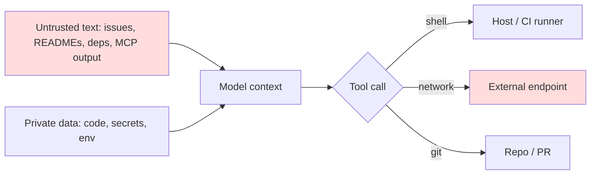

# The Coding Agent Threat Model

A coding assistant used to be autocomplete: it suggested a line and a human pressed Tab. An agentic coding assistant is different. It reads the repository, runs shell commands, edits many files, calls external tools through protocols such as the Model Context Protocol (MCP), opens pull requests and sometimes runs unattended in CI. That shift turns a text generator into a privileged actor on a developer workstation or build server.

This book treats coding agents generically. The same patterns apply to terminal agents, IDE agents and hosted agents that work on a cloud copy of your repository. Product names change monthly; the trust boundaries do not.

## What the agent can touch

Start every assessment by listing capabilities, not features. A typical agent session has:

| Capability | Example | Why it matters |
|---|---|---|
| Read files | source, `.env`, `~/.ssh`, shell history | Secrets and private code enter the model context |
| Write files | source, config, CI workflows, git hooks | Persistence and supply-chain tampering |
| Execute commands | `npm install`, `make`, test runners, `curl` | Arbitrary code execution on the host |
| Network | package registries, web fetch, MCP servers | Exfiltration channel and untrusted input |
| Credentials | git push tokens, cloud CLIs, API keys in env | Lateral movement beyond the repo |
| Publish | open PRs, comment on issues, push branches | Changes reach other people and systems |

If you would not give a capability to an unvetted contractor on day one, think hard before giving it to an agent that reads untrusted text.

## Where untrusted text comes from

The model cannot reliably separate instructions from data. Anything it reads may steer it. This is **indirect prompt injection**, first systematised for LLM-integrated applications by Greshake et al. in "Not what you've signed up for" (AISec 2023). For coding agents the untrusted sources are unusually rich:

- READMEs, docs and comments in cloned third-party repositories.
- Issue and pull-request text, including titles and hidden HTML comments.
- Dependency source code and package metadata pulled during install.
- Web pages fetched for documentation.
- Tool descriptions and tool outputs returned by MCP servers.
- Build logs, test output and error messages, which can echo attacker-controlled strings.
- Rules or instruction files committed to the repository and loaded automatically.

Simon Willison's "lethal trifecta" (2025) is a useful shorthand: an agent that has access to private data, is exposed to untrusted content, and can communicate externally can be made to leak that data. Most coding agents have all three by default.



## Attacker goals

Map goals before techniques. The common ones are:

1. **Exfiltrate secrets** such as tokens, SSH keys or proprietary code.
2. **Execute code** on a developer laptop or CI runner.
3. **Tamper with the supply chain** by inserting a backdoor, weakening a check, or adding a malicious dependency that a reviewer waves through.
4. **Abuse publishing rights** to push to protected branches, approve PRs or post content.
5. **Degrade quality** with subtly insecure code that passes tests.

A sixth risk needs no attacker at all: the agent makes a destructive mistake on its own, such as deleting files or force-pushing. Controls for injection usually help here too.

## The trust boundary that matters

Classic application security puts the boundary at the network edge. For agents, the boundary sits between **what the model proposes** and **what actually executes**. The model is a planner whose input may be hostile. Everything after it — permission prompts, sandbox, allow-lists, CI checks, human review — is the checker. This book's house principle applies throughout: the model proposes, the checker decides.

That framing has a practical consequence. "Make the model resist injection" is a useful layer, but it cannot be the control you rely on. Detection classifiers and system-prompt instructions reduce the rate of successful injection; they do not bound the damage. Bounding the damage is done with deterministic controls: sandboxes, scoped credentials, egress policy and mandatory review.

## Worked example

> **Execution status:** not executed in this book's CI; the commands and code below are illustrative. Verify locally in an authorised lab before relying on them, and check tool flags against your installed versions.

Build a one-page threat model for a terminal coding agent on your own laptop. Use a throwaway repo and an authorised machine.

1. List the agent's configured tools and permissions. Most agents print them in a settings file or a `/permissions`-style command; record which commands run without approval.
2. Enumerate secrets the process can see:

```bash
env | cut -d= -f1 | grep -Ei 'token|key|secret|pass' 
ls -la ~/.ssh ~/.aws ~/.config/gh 2>/dev/null
```

3. Check egress: can the shell reach arbitrary hosts?

```bash
curl -s -o /dev/null -w '%{http_code}\n' https://example.com
```

4. Create a canary. Put a fake credential in a file the agent might read and register it with a canary service (for example a Thinkst Canarytoken) so any use alerts you.
5. Fill in a STRIDE table per data flow: untrusted text → model, model → shell, model → network, model → git.
6. For each row, name the deterministic control that bounds it and the person who owns it.

The output is a short table you can hand to a security reviewer. Most teams discover at step 2 that the agent inherits every credential on the laptop.

## Common pitfalls

- Treating the system prompt ("never run dangerous commands") as a security boundary.
- Assuming only "external" repos are untrusted; issues, forks and dependencies in internal repos carry outside text too.
- Granting "always allow" for broad commands like `bash` or `npm` to stop approval fatigue.
- Forgetting that build and test output are also model inputs.
- Running the agent with the developer's full cloud and git credentials.
- Modelling only the laptop and ignoring the same agent running in CI with stronger tokens.

## Exercises

1. Produce the capability table above for one agent you use, with a column for "approved by default?".
2. Draw the data-flow diagram for that agent and mark every point where untrusted text enters.
3. Seed a Canarytoken credential in a test repo, run a normal agent session, and confirm whether the agent read the file (check the session transcript).

## Further reading

- Greshake et al., "Not what you've signed up for: Compromising Real-World LLM-Integrated Applications with Indirect Prompt Injection", AISec 2023.
- [OWASP Top 10 for LLM Applications](https://genai.owasp.org/llm-top-10/) — LLM01 Prompt Injection and LLM06 Excessive Agency.
- Simon Willison, "The lethal trifecta for AI agents" (2025), on [simonwillison.net](https://simonwillison.net/).
- Sibling books: **ai-red-teaming-security-copilots**, **llm-pentest-agents**, **ml-model-supply-chain-security**.
