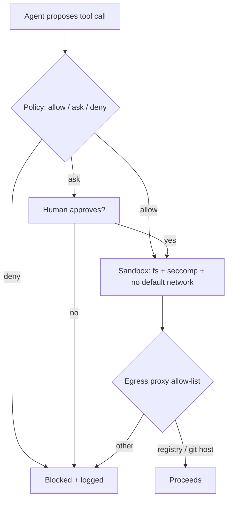

# MCP Servers, Tool Permissions and Sandboxing

An agent is only as dangerous as the tools it can call. This chapter covers the three layers that decide what a proposed action is allowed to do: the tool surface (including MCP servers), the permission policy, and the sandbox underneath both.

## MCP in one paragraph

The Model Context Protocol, published by Anthropic in late 2024 and now supported by many clients, standardises how an agent discovers and calls external tools. An MCP server advertises tools with names, descriptions and input schemas; the client puts those descriptions into the model's context; the model emits tool calls; the client forwards them. Servers run locally (often over stdio, as a child process with your user's privileges) or remotely (over HTTP, usually with OAuth).

That design gives three distinct risks:

| Risk | Mechanism | Primary control |
|---|---|---|
| Malicious or compromised server | It is code running as you, or a remote service you trust with tokens | Vet, pin and sandbox servers |
| Tool poisoning | Tool descriptions contain hidden instructions the model reads | Review and pin descriptions; alert on change |
| Confused deputy | A benign server with a broad token does what injected text asks | Least-privilege tokens per session |
| Cross-server shadowing | One server's description tells the model how to use another server's tools | Isolate sensitive servers into separate sessions |
| Output injection | Data returned by a tool (web page, issue, DB row) carries instructions | Treat all tool output as untrusted |

Invariant Labs described "tool poisoning" and the related "rug pull" (a server changing its descriptions after approval) in 2025. The practical lesson: a tool description is prompt text from a third party, and it is loaded into every session.

## Permission policy

Most agents offer modes along a spectrum: ask for everything, allow reads and ask for writes, allow a list of commands, or allow everything. Write the policy down as a file in the repository so it is reviewable, and prefer allow-lists of exact commands over broad patterns.

A policy sketch, in a generic format:

```yaml
allow:
  - "read:**"            # except denied paths below
  - "shell:npm test"
  - "shell:git diff*"
  - "shell:git status"
ask:
  - "edit:**"
  - "shell:npm install*"
deny:
  - "read:.env*"
  - "read:~/.ssh/**"
  - "shell:curl*"
  - "shell:git push*"
  - "edit:.github/workflows/**"
```

Pattern-based shell allow-lists are weaker than they look. `npm test` runs whatever the `test` script says, and the agent can edit `package.json`. `git diff` can invoke a configured external diff tool. Treat command allow-lists as friction for the honest case, and rely on the sandbox for the adversarial case.

## Sandboxing

The sandbox is the checker that does not care what the model was told. Useful options, from lightest to strongest:

- **OS-level process sandbox:** `bubblewrap` or `firejail` on Linux, `sandbox-exec` profiles on macOS. Several agents ship built-in sandboxes based on these primitives. Restrict the writable paths to the project directory and block network by default.
- **Containers / dev containers:** run the agent inside a container with only the repo mounted. Do not mount the Docker socket or your home directory.
- **gVisor or microVMs (Firecracker, Kata):** stronger kernel isolation for untrusted repos or CI.
- **Disposable cloud workspaces:** a fresh VM per task, with credentials injected per task and destroyed afterwards.

Egress control is the part teams skip. Without it, any read of a secret is one `curl` away from exfiltration. Route the sandbox through a proxy that allows only package registries and your git host.



## Worked example

> **Execution status:** not executed in this book's CI; the commands and code below are illustrative. Verify locally in an authorised lab before relying on them, and check tool flags against your installed versions.

Run an agent's shell commands inside a network-less bubblewrap sandbox with only the project writable. This is Linux-only and assumes `bwrap` is installed.

1. Create a wrapper script `agent-sh`:

```bash
#!/usr/bin/env bash
exec bwrap \
  --ro-bind /usr /usr --ro-bind /etc /etc \
  --symlink usr/lib /lib --symlink usr/lib64 /lib64 --symlink usr/bin /bin \
  --proc /proc --dev /dev --tmpfs /tmp \
  --bind "$PWD" "$PWD" --chdir "$PWD" \
  --unshare-all --die-with-parent \
  --setenv HOME /tmp \
  bash -c "$*"
```

2. Verify isolation with deterministic checks, not by asking the agent:

```bash
./agent-sh 'curl -sS https://example.com' ; echo "exit=$?"   # expect failure
./agent-sh 'ls ~/.ssh' ; echo "exit=$?"                       # expect failure
./agent-sh 'touch ok.txt && ls ok.txt'                         # expect success
```

3. Point your agent's shell tool (or its sandbox configuration) at this wrapper, or run the whole agent inside it.
4. For MCP, list configured servers, record each server's package version and a hash of its tool descriptions, and re-check the hash at session start. The [mcp-scan](https://github.com/invariantlabs-ai/mcp-scan) tool from Invariant Labs automates description pinning and inspection.
5. Re-run the canary injection test from chapter 2 and confirm the riskier variants now fail at the sandbox, regardless of what the model attempted.

## Common pitfalls

- Installing MCP servers with `npx some-server@latest`, which pulls new code every launch.
- One long-lived GitHub token with `repo` scope shared by every MCP server and session.
- Sandboxing the shell tool but not MCP servers, which run as separate processes with full user rights.
- Allowing network "just for package installs" with no destination allow-list.
- Mounting `$HOME` into the container for convenience, bringing every credential with it.
- Never re-reviewing tool descriptions after the initial approval.

## Exercises

1. Inventory every MCP server your team uses: source, pinned version, transport, credentials held, and who approved it.
2. Build the bubblewrap wrapper above and write three automated tests that prove network, home directory and out-of-tree writes are blocked.
3. Write a script that hashes each server's tool list (from the `tools/list` response) and fails if it changes between sessions.

## Further reading

- [Model Context Protocol specification](https://modelcontextprotocol.io/), including its security best-practices section.
- Invariant Labs, "MCP Security Notification: Tool Poisoning Attacks" (2025), [invariantlabs.ai](https://invariantlabs.ai/blog).
- [bubblewrap](https://github.com/containers/bubblewrap) and [gVisor](https://gvisor.dev/).
- Sibling book: **llm-pentest-agents** for scope enforcement in offensive agents.
