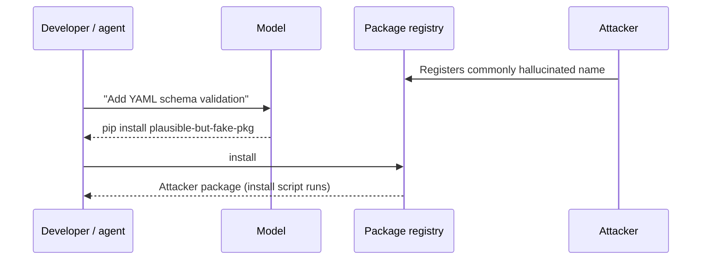

# Insecure Generated Code and Slopsquatting

Not every risk from a coding agent needs an attacker in the loop. Models write plausible code, and plausible code is not the same as secure code. They also recommend dependencies, some of which do not exist — a gap attackers have learned to fill. This chapter covers both and the checks that catch them.

## What the research says

Pearce et al., "Asleep at the Keyboard? Assessing the Security of GitHub Copilot's Code Contributions" (IEEE S&P 2022), prompted an early Copilot with scenarios built around MITRE CWE Top 25 weaknesses and found that roughly 40% of the generated programs were vulnerable. Models have improved since, and newer studies report a range of results, but the pattern holds: generated code reflects the insecure idioms in its training data, and it is most risky exactly where security depends on context the model does not have, such as which input is trusted.

Recurring weakness classes in generated code:

| Weakness | Typical shape | Catching check |
|---|---|---|
| Injection (CWE-89, CWE-78) | String-built SQL or shell commands | Semgrep/CodeQL taint rules |
| Path traversal (CWE-22) | Joining user input into file paths | Taint rules, unit tests with `../` |
| Weak crypto (CWE-327) | MD5/SHA-1 for passwords, ECB mode, static IVs | Semgrep crypto rules, Bandit |
| Hard-coded secrets (CWE-798) | Example keys left in code | gitleaks |
| Disabled verification | `verify=False`, permissive CORS, `chmod 777` | Linters, policy rules |
| Missing authorisation | New endpoint without access checks | Review + integration tests |

Agents add a twist: when a test fails, an agent may "fix" it by weakening the check — catching and ignoring an exception, loosening a regex, or skipping the test. Diff review should look for deleted assertions and new `skip` markers as carefully as for new code.

## Package hallucination and slopsquatting

Models sometimes import or install packages that do not exist. Spracklen et al., "We Have a Package for You! A Comprehensive Analysis of Package Hallucinations by Code Generating LLMs" (USENIX Security 2025), measured this across many models for Python and JavaScript. They found a non-trivial share of recommended packages were hallucinated, open models hallucinated more than commercial ones, and many hallucinated names recurred across runs. Recurrence is what makes it exploitable: an attacker can register a name that models predictably invent.

Seth Larson coined the term **slopsquatting** for this in 2025. Earlier, Bar Lanyado of Lasso Security reported registering an empty package under a name models repeatedly hallucinated and observing substantial download counts, which showed the attack path is real even without a malicious payload.



Controls are about refusing unknown names before install:

- **Allow-list or proxy:** route installs through an internal registry proxy (for example Artifactory, Nexus, or a curated mirror) that only serves approved packages.
- **Age and popularity gates:** block packages first published recently or with very few downloads unless approved.
- **Reputation scanners:** tools such as Socket, OpenSSF Package Analysis results and `osv-scanner` for known-malicious advisories.
- **Lockfiles and review:** new entries in `package-lock.json`, `poetry.lock` or `Cargo.lock` require a human approver.

## Worked example

> **Execution status:** not executed in this book's CI; the commands and code below are illustrative. Verify locally in an authorised lab before relying on them, and check tool flags against your installed versions.

Add a CI gate that checks every dependency introduced by a PR exists, is not brand new, and has no known malicious or vulnerable advisory. Python shown; the same shape works for npm.

1. Extract added requirements from the diff:

```bash
git diff origin/main -- requirements.txt | grep '^+[^+]' | sed 's/^+//' | cut -d'=' -f1 > new-deps.txt
```

2. Check each name exists and get its first release date from the PyPI JSON API:

```bash
while read -r pkg; do
  meta=$(curl -sf "https://pypi.org/pypi/${pkg}/json") || { echo "MISSING: $pkg"; exit 1; }
  first=$(echo "$meta" | jq -r '[.releases[][]?.upload_time] | min')
  echo "$pkg first published $first"
done < new-deps.txt
```

3. Fail the job if the first release is under 90 days old unless the PR carries an approved label.
4. Run known-vulnerability and malicious-package checks:

```bash
osv-scanner scan source -r .
pip-audit -r requirements.txt
```

5. Run SAST on the changed files:

```bash
semgrep scan --config p/python --config p/secrets --error
```

6. Require a human approval from a dependency owner for any new lockfile entry.

Each step is a deterministic check. The agent can propose a dependency; the gate decides.

## Common pitfalls

- Letting the agent run `pip install` or `npm install` directly on suggested names during exploration.
- Treating "tests pass" as evidence of security when the agent wrote both code and tests.
- Missing weakened checks: deleted assertions, broad `except`, new `@pytest.mark.skip`.
- Only scanning for known CVEs; slopsquatted packages are new and have no CVE.
- Running SAST with default rules that ignore the framework your code actually uses.

## Exercises

1. Ask a model for ten code snippets in a niche domain and record every imported package; check each against the registry and count the ones that do not exist.
2. Implement the new-dependency gate above for your package manager and test it with a fake package name.
3. Write a Semgrep rule that flags removed `assert` lines or new test-skip decorators in a diff, and run it on recent agent-authored PRs.

## Further reading

- Pearce et al., "Asleep at the Keyboard? Assessing the Security of GitHub Copilot's Code Contributions", IEEE S&P 2022.
- Spracklen et al., "We Have a Package for You! A Comprehensive Analysis of Package Hallucinations by Code Generating LLMs", USENIX Security 2025.
- [Semgrep](https://semgrep.dev/), [CodeQL](https://codeql.github.com/), [OSV-Scanner](https://github.com/google/osv-scanner), [pip-audit](https://github.com/pypa/pip-audit).
- Sibling books: **ai-static-analysis-rule-writing**, **code-model-data-poisoning**, **web3-supply-chain-security**.
