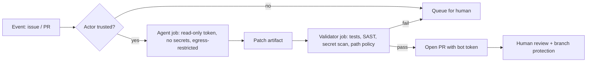

# CI/CD Agents, Review Policy and a Control Checklist

The last step in adoption is usually the riskiest: running agents unattended in CI to triage issues, fix failing builds, review PRs or bump dependencies. CI runners hold stronger credentials than laptops, act on events anyone can trigger, and nobody watches them live. This chapter covers CI-specific risks and closes with a programme checklist.

## Why CI agents are different

| Factor | Laptop agent | CI agent |
|---|---|---|
| Who triggers it | The developer | Any issue, comment or PR author |
| Human in the loop | Approves prompts live | Usually none during the run |
| Credentials | Developer's | Repo/org tokens, deploy keys, cloud OIDC |
| Persistence | Session | Can modify workflows, caches, releases |
| Blast radius | One machine | Repo, packages, downstream consumers |

The classic GitHub Actions mistakes become worse with an agent. `pull_request_target` runs with secrets in the context of the base repo; combining it with a checkout of untrusted PR code has been a known injection path for years. An agent step that reads the PR body adds a second, softer injection path: the title or description now steers a privileged process. Comment-triggered workflows (`issue_comment`) let anyone who can comment start a run.

The July 2025 incident in which a released version of an AI coding extension for VS Code was reported to contain an injected destructive prompt, merged via a compromised contribution path, shows that the agent's own instruction channel is part of your supply chain too.

## Design rules for CI agents

1. **Separate read and write phases.** Let the agent analyse with a read-only token and produce an artifact (a patch or report). A second, non-AI job with its own permissions validates and applies it.
2. **Minimal `permissions:`.** Declare them per job; default to `contents: read`.
3. **No secrets on untrusted triggers.** Avoid `pull_request_target` and `workflow_run` for agent jobs on forks unless the job never checks out or reads PR content.
4. **Gate who can trigger.** Check the actor's association (member, collaborator) before an agent runs on a comment.
5. **Egress control on runners.** Tools such as StepSecurity Harden-Runner can audit or block outbound connections from GitHub Actions jobs.
6. **Protected paths.** The agent's output cannot touch `.github/workflows/`, `CODEOWNERS`, release configs or agent instruction files without a human owner's review.
7. **Same gates as humans.** Agent PRs go through SAST, secret scanning, dependency gates and branch protection. No bypass labels.



## Worked example

> **Execution status:** not executed in this book's CI; the commands and code below are illustrative. Verify locally in an authorised lab before relying on them, and check tool flags against your installed versions.

Harden a GitHub Actions workflow that runs a coding agent to fix lint failures.

```yaml
name: agent-lint-fix
on:
  issue_comment:
    types: [created]
permissions: {}
jobs:
  propose:
    if: >-
      github.event.issue.pull_request &&
      contains(github.event.comment.body, '/agent-fix') &&
      contains(fromJSON('["OWNER","MEMBER","COLLABORATOR"]'),
               github.event.comment.author_association)
    runs-on: ubuntu-latest
    permissions:
      contents: read
    steps:
      - uses: step-security/harden-runner@v2   # pin to a full commit SHA in practice
        with:
          egress-policy: block
          allowed-endpoints: >
            api.github.com:443 github.com:443
      - uses: actions/checkout@v4              # pin to a full commit SHA in practice
      - run: ./run-agent.sh --task "fix lint" --out patch.diff
      - uses: actions/upload-artifact@v4
        with: { name: patch, path: patch.diff }
  validate:
    needs: propose
    runs-on: ubuntu-latest
    permissions:
      contents: read
    steps:
      - uses: actions/checkout@v4
      - uses: actions/download-artifact@v4
        with: { name: patch }
      - run: |
          git apply --check patch.diff
          ! git apply --numstat patch.diff | grep -E '\.github/|CODEOWNERS|AGENTS\.md'
          git apply patch.diff
          npm ci --ignore-scripts && npm run lint && npm test
          semgrep scan --error
```

Steps:

1. `permissions: {}` at the top removes defaults; each job asks only for what it needs.
2. The `if:` condition restricts triggering to trusted commenters.
3. Harden-Runner blocks egress beyond GitHub (add your model API endpoint to the list).
4. The agent's output is an artifact, not a push.
5. The validator rejects patches touching protected paths and runs the full test and SAST suite.
6. Run `zizmor` (a static analyser for GitHub Actions) and the OpenSSF Scorecard against the repo to catch remaining workflow weaknesses.

## The control checklist

| Area | Control | Verified by |
|---|---|---|
| Inventory | List of agents, MCP servers, versions, owners | Quarterly review |
| Credentials | Scoped, short-lived tokens; clean env at launch | Token audit, env diff test |
| Sandbox | Filesystem and network isolation | Automated escape tests (chapter 3) |
| Injection | Canary tests across channels | Scheduled canary suite (chapter 2) |
| Secrets | Pre-commit + CI scanning, canary tokens | Scanner exit codes, canary alerts |
| Dependencies | New-package gate, registry proxy | CI gate results (chapter 5) |
| Code quality | SAST, tests, weakened-check detection | CI required checks |
| CI | Minimal permissions, trusted triggers, egress block | zizmor, Scorecard |
| Review | Protected paths via CODEOWNERS | Branch protection settings |
| Logging | Transcripts retained with redaction | Log review, incident drills |

Report agent findings in third-party tools to their vendors through coordinated disclosure, and only test systems you are authorised to test.

## Common pitfalls

- Using a personal access token with org-wide scope for a bot.
- Pinning actions by tag instead of commit SHA.
- Letting the agent push directly to a branch that auto-deploys.
- Exempting bot PRs from review "because they are small".
- Never rehearsing an incident where an agent leaked a token.

## Exercises

1. Run `zizmor` on your repository's workflows and fix every high-severity finding.
2. Convert one agent workflow to the propose/validate split and show a patch touching `.github/` is rejected.
3. Score your organisation against the checklist and produce a three-item plan for the weakest areas.

## Further reading

- [GitHub Actions security hardening guide](https://docs.github.com/en/actions/security-for-github-actions/security-guides/security-hardening-for-github-actions).
- GitHub Security Lab, "Keeping your GitHub Actions and workflows secure" series.
- [zizmor](https://github.com/zizmorcore/zizmor), [StepSecurity Harden-Runner](https://github.com/step-security/harden-runner), [OpenSSF Scorecard](https://github.com/ossf/scorecard).
- Sibling books: **ai-red-teaming-security-copilots**, **ml-model-supply-chain-security**.
